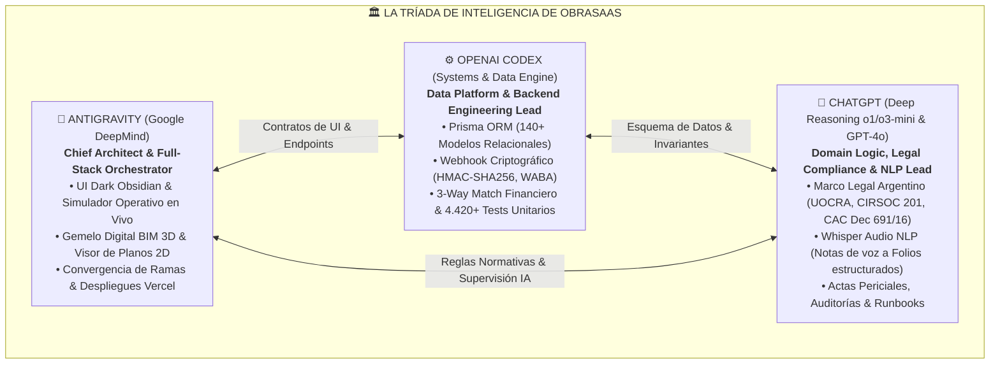
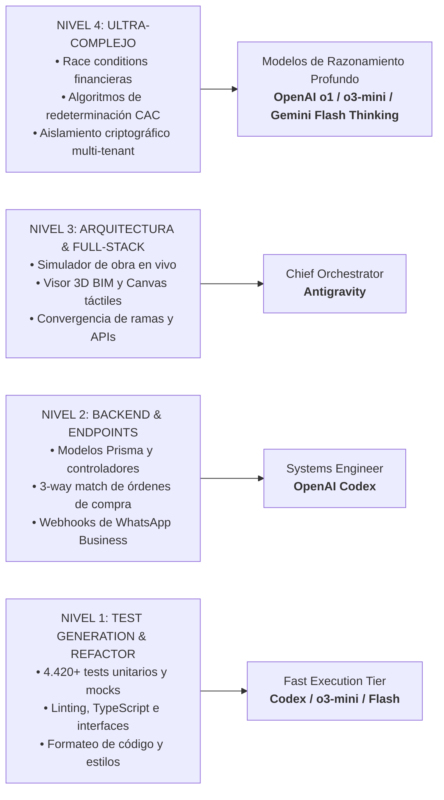

# 🤝 PROTOCOLO DE SINERGIA TRIPARTITA DE IA — OBRASAAS ENTERPRISE
> **Marco Operativo y de Colaboración Armónica entre Antigravity, OpenAI Codex y ChatGPT**  
> **Versión:** 1.0 Universal Triad Protocol  
> **Fecha:** Noviembre 2026  
> **Repositorio Oficial:** `https://github.com/inguillen87/obrasaas.git` (Rama canónica: `master`)  
> **Dominio de Producción:** [obrasaas.com](https://obrasaas.com) | [obrasaas.vercel.app](https://obrasaas.vercel.app)

---

## 🌟 1. MANIFIESTO DE SINERGIA: TRES MODELOS, UN SOLO OBJETIVO

Construir el software más avanzado, robusto y confiable de la industria de la construcción no se logra con un solo modelo de inteligencia artificial de propósito general, sino con una **orquesta coordinada** donde cada modelo ejecuta exclusivamente aquello en lo que supera a todos los demás:



---

## 🎯 2. MATRIZ DE ASIGNACIÓN: "¿QUIÉN HACE QUÉ Y POR QUÉ?"

| Rol / Capacidad | Modelo Asignado | ¿Por qué es el mejor en esto? | Entregables Clave |
| :--- | :---: | :--- | :--- |
| **Arquitectura Global & UI/UX** | **Antigravity** *(Gemini Pro / Flash Thinking)* | Capacidad multimodal masiva, coordinación de diseño Dark Obsidian (`#060913`), renders SVG interactivos y visión espacial BIM 3D. | `/dashboard`, `/bim`, `/planos`, `/ejecutivo`, `/coordinacion`, `@/lib/design-system.js`. |
| **Orquestación & Despliegue** | **Antigravity** *(Google DeepMind)* | Capacidad de ejecutar herramientas nativas, terminales, builds Next.js Turbopack y resolver bloqueos entre ramas y Vercel. | `npm run build`, `npx vercel --prod --yes`, integración de PRs. |
| **Persistencia & Transacciones ACID** | **OpenAI Codex** *(Codex / Specialized CLI)* | Máxima precisión sintáctica en migraciones de base de datos, relaciones de clave foránea e índices de alto rendimiento. | `prisma/schema.prisma` (140+ modelos), migraciones SQL en PostgreSQL/Neon. |
| **Criptografía & Webhooks Seguros** | **OpenAI Codex** *(Codex Engine)* | Cero margen de error en verificación de firmas HMAC-SHA256, rotación de claves de Meta WhatsApp Flows y queues durables. | `signed-webhook-ingress`, `whatsapp-flow-endpoint-crypto`. |
| **Batería de Tests Masivos** | **OpenAI Codex** *(Fast Testing Tier)* | Velocidad y consistencia en generación y ejecución de suites de contrato y regresión (4.420+ tests). | `tests/*.test.js`, `tests/*.test.mjs`, Playwright E2E suites. |
| **Marco Legal & Normativo Argentino** | **ChatGPT** *(OpenAI o1 / o3-mini)* | Razonamiento profundo en leyes laborales y reglamentos técnicos sin alucinaciones de fórmulas ni artículos. | CCT 76/75 UOCRA (Art. 21 lluvia), Ley 22.250, CIRSOC 201, Dec 691/16 CAC. |
| **Supervisión NLP & Whisper Audio** | **ChatGPT** *(GPT-4o / o1)* | Inferencia contextual para convertir jerga y audios ruidosos de obreros en folios del Libro de Obra e incidencias estructuradas. | Transcripción Whisper, extracción de entidades de obra, `/libro-obra`. |
| **Auditoría Legal & Runbooks** | **ChatGPT** *(OpenAI o1 / o3-mini)* | Generación de actas periciales inmutables, pliegos licitatorios con caución y manuales de operaciones. | `/certificacion` (PDF pericial SHA-256), `/compliance`, runbooks en `docs/`. |

---

## 🚦 3. ENRUTAMIENTO DE TAREAS POR NIVEL DE COMPLEJIDAD

Para optimizar recursos y no sobrecargar modelos ligeros con tareas de alto riesgo, ni malgastar modelos de razonamiento profundo en tareas rutinarias, se adopta el siguiente enrutamiento:



---

## 🔄 4. PROTOCOLO DE PASAMANOS Y RAMAS (BRANCHING CONTRACTS)

Para que los tres agentes trabajen al unísono sin pisarse el código:

1. **Rama Canónica (`master`)**:
   - Es la única rama que despliega a producción en Vercel (`obrasaas.com` / `obrasaas.vercel.app`).
   - Solo se mergean cambios que cumplan:
     - `npm run prebuild` con 0 errores.
     - `npm test` con todas las suites en verde.
     - `npm run build` compilando limpio con Next.js Turbopack.
2. **Ramas de Ingeniería de Codex (`codex/*` o `operations/*`)**:
   - Codex desarrolla los modelos en `prisma/schema.prisma`, endpoints en `src/app/api/` y tests en `tests/`.
   - Entrega con un commit descriptivo que indica los tests aprobados.
3. **Ramas de Lógica y Dominio de ChatGPT (`chatgpt/*` o prompts guiados)**:
   - ChatGPT revisa y certifica la lógica legal: fórmulas de redeterminación CAC, cálculo de quincenas UOCRA y validaciones CIRSOC 201.
   - Entrega especificaciones de dominio o extractores NLP.
4. **Rol Integrador de Antigravity (`release/*` o master integration)**:
   - Antigravity conecta los componentes visuales de la interfaz de usuario con los endpoints de backend provistos por Codex y las reglas validadas por ChatGPT.
   - Compila, corre la verificación visual en navegador y ejecuta el push y despliegue en Vercel.

---

## 📋 5. PROMPTS DE ARRANQUE PARA CADA AGENTE

### 🤖 Para OpenAI Codex (Copilot / CLI):
```markdown
Hola Codex. Estás trabajando en el rol de Deep Systems & Backend Engineer dentro de la Tríada de IA de ObraSaaS (https://github.com/inguillen87/obrasaas.git).
Tu responsabilidad en este sprint es la capa de datos y servicios:
1. Revisa prisma/schema.prisma y los endpoints bajo src/app/api/.
2. Asegura que cada modelo cumpla con las restricciones de clave foránea, aislamiento por tenant y atomicidad.
3. Toda nueva funcionalidad debe incluir su suite de tests en tests/*.test.js y verificar con `node --test`.
Regla estricta: No modifiques el diseño visual ni componentes Dark Obsidian en src/app/; enfócate en controladores, transacciones ACID y pruebas de contrato.
```

### 🧠 Para ChatGPT (o1 / o3-mini / GPT-4o):
```markdown
Hola ChatGPT. Estás actuando como Legal/Regulatory Officer y Domain Logic Specialist en la Tríada de IA de ObraSaaS (https://github.com/inguillen87/obrasaas.git).
Tu función es garantizar la rigurosidad normativa y la inteligencia de negocio:
1. Validar que los cálculos de haberes y quincenas cumplan con UOCRA CCT 76/75 (presentismo 20%, horas extras y régimen de lluvia Art. 21 con 2.5 hs mínimas).
2. Auditar que las recepciones de hormigón y probetas respeten el reglamento CIRSOC 201 (asentamiento Cono de Abrams, probetas IRAM 1534).
3. Diseñar los prompts de extracción NLP para que Whisper convierta audios ruidosos de obra en asientos estructurados del Libro de Obra Digital (Ley 22.250).
Documento de referencia: docs/TRIAD_AI_SYNERGY_PROTOCOL.md.
```

### 🦅 Para Antigravity (Google DeepMind):
```markdown
Antigravity actúa como Chief Architect y Master Integrator:
Supervisa la convergencia de la interfaz de usuario Dark Obsidian, integra los endpoints provistos por Codex con las reglas de ChatGPT, ejecuta `npm run build` con Turbopack y garantiza el despliegue continuo en Vercel con 0 errores.
```
